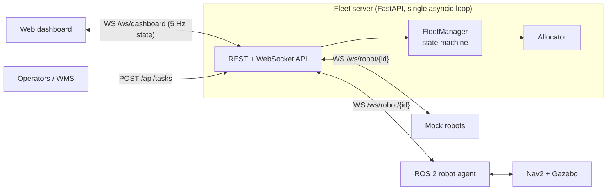

# Warehouse AMR Fleet

A fleet management system for autonomous mobile robots (AMRs) in a warehouse:
task allocation, battery management, fault recovery and a live dashboard,
designed so the same fleet server drives simulated robots, ROS 2 robots in
Gazebo, and (eventually) real hardware.

> **Status:** fleet server, mock robots and dashboard are working and tested.
> ROS 2 / Nav2 integration in Gazebo is in progress — see [Roadmap](#roadmap).

<!-- TODO: add a dashboard GIF here: docs/dashboard.gif -->

## What it does

- **Task allocation** — pickup → dropoff jobs are assigned by priority, then age,
  to the nearest idle robot that has enough battery to finish the job *and*
  still reach a charger afterwards.
- **Battery management** — idle robots below 25% are sent to the nearest *free*
  charger (chargers are a contended resource) and released back to work at 90%.
- **Fault tolerance** — robots that miss heartbeats or disconnect are marked
  offline and their in-flight task is requeued to another robot. Navigation
  failures are retried up to 3 times before a task is marked failed.
- **Live dashboard** — map with robot positions, headings and goals; robot and
  task tables; submit and cancel tasks; event log.
- **Robot-agnostic protocol** — robots speak a small JSON-over-WebSocket protocol,
  so a mock robot, a ROS 2 robot agent and a vendor robot adapter are interchangeable.

## Architecture



| Module | Responsibility |
|---|---|
| [`models.py`](fleet/fleet_server/models.py) | Robot, Task, Pose — plain dataclasses |
| [`allocator.py`](fleet/fleet_server/allocator.py) | Pure function: which robot gets which task |
| [`fleet.py`](fleet/fleet_server/fleet.py) | Fleet state machine: heartbeats, charging, retries, task lifecycle |
| [`protocol.py`](fleet/fleet_server/protocol.py) | Typed robot ↔ server wire protocol |
| [`api.py`](fleet/fleet_server/api.py) | HTTP/WebSocket layer and the 5 Hz control loop |
| [`mock_robot.py`](fleet/fleet_server/mock_robot.py) | Simulated robots for demos and tests |

### Design decisions

- **The core does no I/O.** `FleetManager` takes inputs as method calls and returns
  commands from `tick()`, with an injectable clock. Timeouts, retries and
  charging logic are unit-tested deterministically in milliseconds, with no
  network, ROS or simulator.
- **Single-threaded concurrency.** Every state change happens on one asyncio event
  loop, so there are no locks and no race conditions between telemetry and scheduling.
- **Robots are untrusted input.** Messages are validated with pydantic; a malformed
  message gets an error reply instead of crashing the connection. Stale goal
  results (for goals that were canceled or reassigned) are ignored by goal ID.
- **Losing a robot isn't the task's fault.** Requeues caused by disconnects don't
  count against a task's retry budget; navigation failures do.
- **Greedy allocation, on purpose.** It's O(tasks × robots), predictable, and easy to
  debug on a live fleet. Optimal assignment (Hungarian algorithm) is a drop-in
  replacement behind the same `allocate()` function.

## Quick start

```bash
python3 -m venv .venv && source .venv/bin/activate
pip install -e 'fleet[dev]'

# terminal 1: fleet server + dashboard on http://localhost:8000
python -m fleet_server

# terminal 2: four simulated robots, 5% chance a navigation goal fails
python -m fleet_server.mock_robot --count 4 --fail-rate 0.05
```

Open http://localhost:8000 and click **+5 random** to queue tasks. Kill the
robots process and watch tasks get requeued, then restart it.

```bash
# tests
cd fleet && pytest
```

## ROS 2 workspace (Jazzy)

The robot side is a ROS 2 Jazzy package in [`warehouse_package/`](warehouse_package),
built and tested in Docker so nothing ROS-related needs installing on the host.

| How | Command |
|---|---|
| **VS Code devcontainer** | *Dev Containers: Reopen in Container* (builds the workspace on first open) |
| Robot runtime image | `docker build --target runtime -t warehouse_amr .` |
| Nav2 + Gazebo desktop | `docker compose up sim`, then open http://localhost:8080 |
| Build + test, same as CI | `docker build --target build -t warehouse_amr:build . && docker run --rm warehouse_amr:build bash -c "colcon test && colcon test-result --verbose"` |

The [Dockerfile](Dockerfile) is multi-stage: `base` resolves every dependency
from `package.xml` with rosdep, `dev` adds tooling for the devcontainer, `build`
runs `colcon build`, and `runtime` is a slim `ros-core` image holding only exec
dependencies and the built `install/` tree.

### CI

[GitHub Actions](.github/workflows/ci.yml) runs on every pull request:

1. **fleet-server**: pytest on Python 3.10 and 3.12
2. **ros2**: `colcon build` + `colcon test` (unit tests, flake8, pep257) in `ros:jazzy-ros-base`
3. **docker**: builds the `runtime` image with layer caching; on `main` and `v*`
   tags it is pushed to `ghcr.io/<owner>/warehouse_amr`, tagged by commit SHA,
   branch and version

## Robot protocol

Robots connect to `ws://<server>/ws/robot/<robot_id>`:

| Direction | Message |
|---|---|
| robot → server | `{"type": "telemetry", "pose": {"x", "y", "yaw"}, "battery": 87.5}` (≥ every 5 s) |
| robot → server | `{"type": "goal_result", "goal_id": "G-12", "success": true, "reason": null}` |
| server → robot | `{"type": "navigate", "goal_id", "kind": "task"\|"charge", "label", "x", "y", "yaw"}` |
| server → robot | `{"type": "cancel"}` |

## Roadmap

- [x] Fleet server: allocation, charging, heartbeats, retries
- [x] Live dashboard
- [x] Mock robots + test suite + CI
- [x] ROS 2 Jazzy workspace: multi-stage Docker, devcontainer, colcon CI, GHCR images
- [ ] ROS 2 robot agent: bridges the protocol to Nav2 `NavigateToPose` and AMCL pose
- [ ] Multi-robot Gazebo simulation (ROS 2 Jazzy, Gazebo Harmonic, Nav2, TurtleBot)
- [ ] MCAP recording of every run + Foxglove layout for replay
- [ ] Traffic management on a lane graph (avoid head-on deadlocks in aisles)
- [ ] Persistence (Postgres) and Prometheus metrics
- [ ] Open-RMF fleet adapter for interoperability
